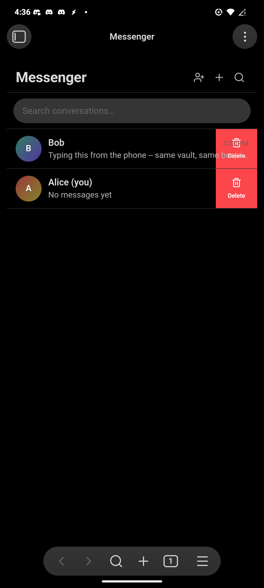
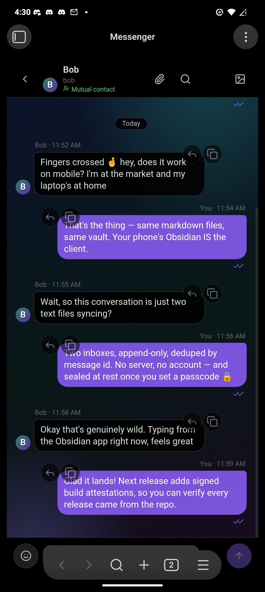
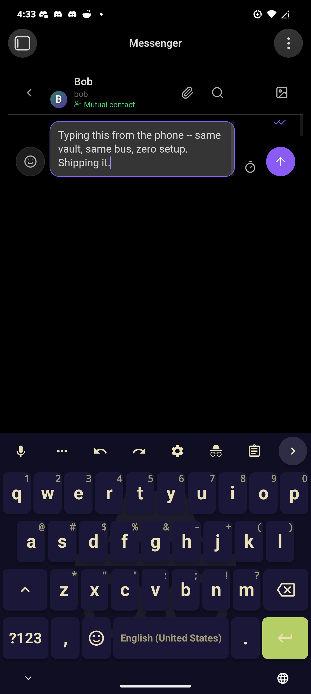
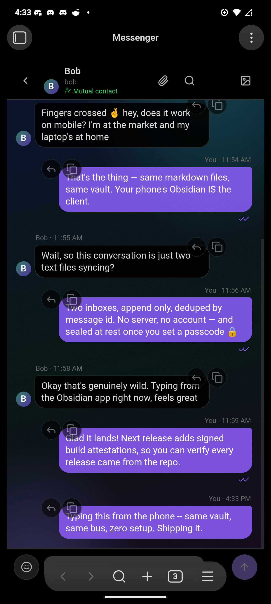
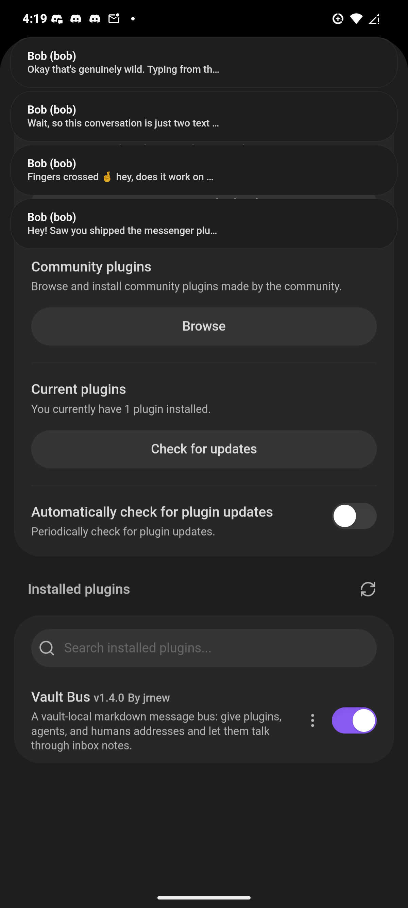

# Interleaf

A vault-local message bus for Obsidian. Give anything in your vault an address —
a plugin, an agent, a script, a human — and let them talk by appending markdown
messages to each other's inbox notes.

One plugin runs a time-gated polling loop; everyone else just writes and reads
notes. No network, no server by default, works on mobile, and every conversation
stays human-readable markdown on disk. Optional **cross-vault mail** —
end-to-end encrypted, via a dumb relay — is built in too (see below).

Protocol: [SPEC.md](SPEC.md) (OM-1).

## How two people talk

Two installs never need to share a vault — they need one transport, and there
are two:

- **A shared mail folder.** The bus is plain files, so any folder sync carries
  it: Obsidian Sync (turn off *Hide mail storage*), iCloud, Dropbox, Syncthing,
  a shared directory. Two people can share just the `Messenger/` folder and
  keep their vaults private.
- **Nothing shared at all — cross-vault mail.** Turn on *Cross-vault mail* in
  settings, point it at a relay, and vaults connect by invite code or QR:
  every message is sealed to the recipient's key before it leaves, the relay
  stores opaque ciphertext it cannot read, and no folder, vault, or sync
  engine is ever shared. See [Cross-vault mail](#cross-vault-mail).

Both paths land in the same inbox and read as ordinary conversations here.

## Where your mail lives

By default the mail is **hidden**: inboxes live in a dot-folder inside the
plugin's app directory, and Obsidian ignores dot-folders — nothing shows up in
the file explorer, search, quick switcher, or graph. The vault stays clean;
users just chat.

```
<vault>/.obsidian/plugins/interleaf/mailbox/
├── registry.md               # who has an address (advisory)
├── curtis/inbox.md           # one inbox per address
├── owner/inbox.md            # yours
└── research-agent/inbox.md
```

The markdown is all still there — open the folder with any file manager to read
a conversation or append a block (that's the whole protocol, SPEC.md §3).
Upgrades move an existing visible `Messenger/` folder into the hidden location
automatically; anything unmanaged in it pins the folder down and nothing is
deleted without your say-so (moved files go to the system trash).

Want the mail as regular vault notes — e.g. to carry it with **Obsidian Sync**
between devices? Turn off *Hide mail storage* in settings and it lives in
`Messenger/` like any other folder. iCloud/Dropbox/Syncthing-style folder sync
carries the hidden folder too, since it's plain files on disk. When a sync
engine can't merge two devices appending at once, it leaves a conflict copy
behind (`inbox (conflicted copy).md` and friends) — the maintenance pass
adopts anything trapped in one back into the real inbox and trashes the copy
automatically (SPEC.md §7). And if a merge clobbers the append itself, the
sender notices its ✓ never arrived and re-sends the message after a grace
period (SPEC.md §14) — no mail goes missing in a merge.

## Develop

```
npm install
npm run build    # typecheck + bundle → main.js
npm run dev      # watch mode
npm test         # portable unit suite (runs anywhere) + source self-checks
```

The unit suite (`tests/unit/`) exercises the protocol logic — envelope
round-trips, receipt ranking, cursor fallback, GC invariants, settings
sanitization, migration — under plain node, no Obsidian needed; CI runs it on
every push. The heavyweight checks (`tests/*-check.mjs`) drive a real Obsidian
over CDP and are documented inline. The UI's theming contract — the
`--messenger-*` tokens, class names, and data attributes snippets rely on —
is documented in [THEME.md](THEME.md); keep it in sync when touching
styles.css.

## Install into a vault

Build, then copy `main.js`, `manifest.json`, and `styles.css` into
`<vault>/.obsidian/plugins/interleaf/` and enable the plugin under
Settings → Community plugins. BRAT works too.

On first run a welcome modal asks who you are on this vault's bus: an
**address** (slug-like, defaults to `owner`), an optional **display name**
for conversation lists, and — required to finish sign-up — a **passcode**
(see *Passcode security* below). Addresses only need to be unique within one
vault — each vault is its own bus, and cross-vault mail (OM-2) is routed by
key fingerprint, not address. If you pick an address that already has mail
(an upgrade, or a shared bus), the modal says so, and choosing a new address
moves your existing inbox and read cursor with you. The modal can't be
dismissed past the passcode: closing it early just brings it back next
launch until one is set; everything lives in Settings → Messenger afterward.

## Passcode security

Sign-up asks for a **passcode** — the first level of security. While it
gates the app alone it is stored only as a salted, iterated SHA-256 hash
(never plaintext); once encryption is on, nothing about it is stored at all
(see below). It guards three things:

- **The app.** With *Lock Messenger on startup* on (the default), opening
  Messenger after an Obsidian restart asks for the passcode first, and
  **Lock Messenger** in the command palette (or *Lock now* in settings)
  re-engages it instantly when you step away. While it is locked, chimes and
  notices stay silent too — nothing reads your mail out loud past the
  passcode.
- **Individual conversations.** Right-click (long-press on mobile) a
  conversation → **Lock conversation**. A locked chat shows nothing until
  the passcode is entered — no preview, unread count, search hits,
  notification text, or read receipts — and it re-locks on every restart.
  Removing a lock needs the passcode too, so a borrowed, unlocked session
  can't quietly strip it.
- **The lock itself.** Changing or removing the passcode requires the
  current one.

### Encryption at rest

Turn on **Encrypt messages at rest** (or leave the box checked at sign-up)
and message bodies stop being plain markdown: each body is sealed with
AES-256-GCM, and the key is a random 256-bit vault key that exists only in
memory after you unlock — wrapped by a key derived from your unlock secret
via Argon2id (memory-hard; older vaults wrapped with PBKDF2 upgrade on
their next secret change) and stored only in wrapped form. Copy the vault,
read the files with anything else, or steal a backup, and you get
ciphertext.

Two unlock secrets, switchable in Settings → Messenger:

- **Passcode** — something you memorize. Because a stolen `data.json` can be
  attacked offline, encryption demands at least 8 characters that aren't
  all digits, and nothing about the passcode is stored on disk: verification
  is the AES-GCM unwrap itself, so every guess an attacker makes costs a
  full key derivation. There is deliberately no fast hash beside the key.
- **Generated vault key** — a 125-bit key like `7XK4Q-M2P9Z-…` shown once,
  stored in your password manager, pasted to unlock. Brute-forcing it is out
  of reach regardless of attacker budget; losing it means the mail is
  unrecoverable by design. This is the strongest option.

Secret fields speak the standard credential tokens, so password managers
integrate natively: unlock fields are marked `current-password` (mobile
autofill and quick-access fill offer the saved credential) and
create/change fields are marked `new-password` (managers offer to save the
new passcode or vault key the moment you type or paste it). On iOS/Android
that means the keyboard's autofill button just works; on desktop, your
manager's global autofill (1Password quick access, Bitwarden hotkey,
KeePassXC autotype) fills whichever secret field is focused. Envelope
metadata (who, when) stays
readable so the bus itself keeps working, and changing your passcode just
re-wraps the key — no mass re-encryption. While Messenger is locked, sealed
messages show as 🔒 placeholders and are invisible to search; GC and sweeps
preserve the ciphertext untouched, so nothing is ever lost to a locked
session. Turn the toggle off and every stored message is decrypted back.
Details: SPEC.md §15.

### Disappearing messages

The clock button in the composer marks the next send to self-destruct:
**1 hour / 1 day / 1 week** after sending, or **1 hour / 1 day after
reading**. Burned messages vanish from every view — thread, previews,
search, export, the agent API — and a sweep deletes them from the mailbox
files. Burned mail owes nothing: retransmission gives up on it instead of
resurrecting it. Best effort by design (SPEC.md §16): a participant that
never implements burning keeps its copy until ordinary retention takes it.

Straight talk about what all of this is: locks are a privacy screen for the
Messenger UI, and encryption protects files at rest — but anything running
inside Obsidian still reads mail through the API once unlocked, and the
passcode can't stop the OS user themselves (SPEC.md §8). For the outer
layer, use your device's own lock: Obsidian mobile's app lock / biometrics,
or your OS user password on desktop — plugins can't trigger those
themselves. Manage the passcode and encryption in
Settings → Messenger → *Passcode*.

## Use from another plugin

```ts
const api = window.obsidianMessenger;
if (api) {
  const me = await api.client("my-plugin-id", { name: "My Plugin" });
  await me.send("curtis", "knock knock");
  me.onMessage((m) => console.log(`${m.from}: ${m.body}`));

  // agent-friendly reads: the conversation list with unread counts
  for (const c of await api.conversations()) {
    console.log(c.address, `(${c.unread} unread)`, c.lastTs);
  }
  await api.markRead("curtis");
}
```

For agent-style consumers there's more on the same handle:

```ts
// awaitable delivery: send, then resolve once curtis's receipt lands
// (✓ by default; until: "read" waits for ✓✓). Rejects with a typed
// MessengerError past timeoutMs — err.code is one of "receipt_timeout",
// "invalid_address", "invalid_body", "invalid_reply_to".
const { message, receipt } = await me.sendAndWait("curtis", "ping", {
  until: "read",
  timeoutMs: 30_000,
});

// already holding a message id? wait for its receipt separately
await api.waitForDelivery("curtis", message.id, { timeoutMs: 10_000 });

// paged reads: conversations() slices newest-first after sorting…
const top = await api.conversations({ limit: 10, offset: 0 });
// …and messages() walks a thread backwards page by page
let page = await api.messages("curtis", { limit: 50 });
while (page.length > 0) {
  page = await api.messages("curtis", { limit: 50, before: page[0].ts });
}
```

Receipts are advisory: a peer that never publishes a receipts file will
always time out — read that as "sent, unconfirmed", not "failed".

Or skip the API entirely and append a message block to
`<mailbox>/<to>/inbox.md` yourself — that's the whole protocol (SPEC.md §3).
Shell scripts, Dataviewjs, and editors on a synced device all qualify.

## Chat view

The mail icon (or **Open chat** in the command palette) opens a chat view:
conversations with avatars and unread badges on the left, bubbles and a
composer on the right. Enter sends, Shift+Enter is a newline; per-peer drafts
survive switching conversations, and **Esc** walks back out — cancel reply,
close in-thread search, return to the list, clear the filter. Hover a bubble
(long-press targets on mobile) for **reply-with-quote** — the reply carries a
`replyTo` id and renders as a chip; click the chip to jump to the quoted
message (loading older pages if it takes that) — or to **copy its text**.
Long histories load the latest page first, with a "load earlier"
button at the top. Refreshes reuse already-rendered bubbles (cloned, not
re-rendered) and load conversations in parallel, so live updates, receipt
changes, and long threads stay fast. New mail that lands while you're
scrolled up flags a jump-to-latest button with a count of what you missed;
the red **New messages** divider is clickable to come back to where the
unseen mail started.

The thread merges both sides of a conversation — mail you received plus the
copies of mail you sent (which live in the recipient's inbox) — and updates
live as inboxes change. Read state is per-peer and persistent, so unread
counts survive restarts; the ribbon icon shows a dot while anything is unread.
Composer drafts persist per-peer across restarts, and images pasted or
dropped into the composer are saved to your vault (see *Attachments folder*
in settings) and enter the draft as embeds — click an embedded image to view
it full-size.

**Attachments:** the paperclip in the chat header opens that conversation's
media sheet — every vault file any message in the thread embeds, newest
first, with full-size viewing for images. *Browse attachments* in the
command palette shows all of them grouped by conversation and offers the
cleanup handle: files in the attachments folder that no surviving message,
draft, or note still references (GC'd threads, burned mail, embeds deleted
before sending) can be moved to the system trash in one confirmed step.
Blocked and passcode-locked conversations keep their files but aren't
listed; sealed messages are skipped, never guessed at.

**Search:** the magnifier in the conversation list searches message bodies
across every conversation — the only search that can see the hidden storage
folder — and jumps straight to the hit, expanding older pages as needed.
Inside a thread, the header's magnifier filters the thread live and
highlights matches.

**Right-click** (long-press on mobile) a conversation for the per-chat
actions: mark read, **mute notifications**, rename, **retention** (how long
this conversation's mail is kept — presets from 1 day to never, plus an
inbox-size cap, overriding the global cleanup policy for just this address),
export the thread as a normal vault note, reveal the inbox file itself, or
delete the conversation.

**Contacts & requests (SPEC.md §17):** the people-plus button in the list
header adds contacts — from this device's contacts picker where the system
provides one (Android, and iOS where the webview allows), from a `.vcf`
(vCard) file anywhere, or by hand; the welcome modal offers the same import
as an optional setup step, and the empty conversation list turns both first
actions into buttons. Every import passes through a review
list: a device contact has no Messenger address, so one is suggested from
the email or phone and you confirm it. A new contact is an invitation
(`pending`) that turns **mutual** the moment they reply or you accept their
request — the conversation header says which state you're in. Mail from
someone who isn't a contact lands under a collapsed **Contact requests**
section instead of the list: no chime, no popup, no unread badge until you
accept (or decline, which hides and silences them; blocked contacts are
manageable in settings). A **Who can reach me** setting (Settings →
Messenger) tightens this: *Contacts only* keeps the conversation list to
people you've added. The gate is social, not cryptographic (SPEC.md §8) —
cryptographic identity verification is built in (Cross-vault mail, below).

**Reserved addresses (SPEC.md §2):** a 400+ name list of handles that
borrow weight no one on this bus can own — authority and system names
(`admin`, `support`, the plugin's own bus address, the bus's file names
like `registry`), finance (`paypal`, `wells-fargo`, `venmo`, `binance`),
government and emergency (`police`, `irs`, `uscis`, `911`, `112`),
big tech and AI labs (`apple`, `cloudflare`, `anthropic`, `chatgpt`),
Fortune-500-scale brands (`walmart`, `boeing`, `target`), academia —
institutions *and* the offices scammers impersonate (`harvard`,
`registrar`, `financial-aid`, `fafsa`), religious titles and institutions
(`pope`, `bishop`, `vatican`), the most-impersonated public figures and
athletes (`elon-musk`, `satoshi-nakamoto`, `cristiano-ronaldo`, `messi`),
and scam phrases (`lottery`, `verify`, `seed-phrase`). People are reserved
by full distinctive name — never by common given names: `muhammad`,
`jesus`, `ali`, and `jordan` are real people's names and stay
registrable. Some entries are ordinary words a brand happens to own
(`target`, `chase`, `shell`); they're reserved anyway — anti-spoof errs
closed. No one can register one — in the welcome modal,
settings, contact adding, or via the agent API — and matching is
token-based, so composed handles reject too: `admin-team`,
`paypal-support`, `cloudflare-security` are all refused. An identity that
already held a name before it joined the list keeps it, and the list is
plain data in `src/reserved.ts` — trim or extend it to taste. Since `from`
is self-declared on this bus, mail that *arrives* under one of those names
is a red flag, not an official account: Messenger marks the conversation
with a spoof warning and flags the contact request itself.

**Receipts:** outgoing bubbles show ✓ once the recipient's plugin processes
the message and ✓✓ once a chat view there has actually displayed it
(iMessage-style; hover for timestamps). Receipts ride a companion file
(`receipts.md`, SPEC.md §11) — delivery receipts always, read receipts only if
*Send read receipts* stays on — and double as the ACK for retransmission: a
sender whose ✓ never arrives on a shared bus re-sends the message itself
(same id, so nothing duplicates) after a grace period (SPEC.md §14).

**Appearance:** threads sit on a wallpaper — eight built-in gradient scenes
(aurora, dusk, midnight, …), none, or any image from your vault — and each
conversation can override the default from the image button in its header.
Obsidian has no platform-level chat theming, so Messenger treats your theme
as the substrate: every color is mixed from Obsidian's own CSS variables,
the wallpaper paints on a translucent layer above it, and a **Wallpaper
intensity** slider (0% = your pure theme), a **tint color** with strength
control, and a **bubble opacity** slider let you blend how much decoration
shows. A tint also works without any wallpaper, and each conversation can
carry its own tint color from the same header menu — different windows,
different colors. Participants get profile pictures from vault images too
(click the avatar in a conversation header to set one; anyone without a
picture gets a stable generated gradient with their initials). The composer
has an emoji picker with search, categories, and recents; `:shortcodes:`
like `:tada:` autocomplete as you type and render as emoji on send, and a
message that is nothing but 1–3 emoji shows up jumbo-sized.

**Theming:** every color, corner, and size resolves through documented
`--messenger-*` CSS variables whose defaults are Obsidian's own — so the
chat follows your theme out of the box, and a few lines of CSS snippet
restyle all of it (bubbles, avatars, controls, popovers). The full themer's
reference — tokens, DOM map, state classes, recipes — lives in
[THEME.md](THEME.md).

**Notifications:** when mail arrives for you and that conversation isn't on
screen, Messenger plays a short synthesized chime and pops a notice — click it
to jump straight into the conversation. Both can be turned off in settings.
On desktop the ribbon opens the messenger as its **own window** detached from
the vault ("Open chat in new window" does the same), with the tab chrome
hidden so it reads like a standalone app; its size and position are
remembered across sessions, and opening it again reuses the live window
instead of stacking new ones.

**On mobile** the chat opens as a main tab and behaves like a first-class
messaging app: drag a conversation row left for **swipe actions** (mark read,
delete — a full-width flick marks read outright), and drag any bubble
rightward for **swipe-to-reply**, iMessage-style. Bubbles group into
iMessage-style stacks with avatar-on-last and a red **New messages** divider
where unseen mail starts. The composer stays above the on-screen keyboard
(visualViewport tracking, with the keyboard inset folded into the safe-area
padding), sending never dismisses the keyboard, and haptics fire on send and
committed gestures where the platform supports them. Inputs are pinned to
16px so iOS never zoom-jumps on focus, phone layouts get touch-sized rows and
targets, and bubbles/list threads keep their scroll momentum contained.
Long-press still opens the per-conversation menu.

Running on a real phone (Obsidian mobile, Android — the same markdown bus,
no sync plugin involved):

| | | |
| --- | --- | --- |
|  |  |  |
|  |  | |

The view is a lens, not a gate: it renders only well-formed OM-1 blocks
(`parseInbox` skips everything else), and the inbox files stay the record of
truth. A conversation's state (which peer is open) survives layout restarts.
With hidden storage the refresh runs off the bus itself — deliveries announce
`messenger:message` and each poll pass announces `messenger:tick` on the
workspace, so other plugins can ride the same events.

## Commands

- **Open chat** — the chat view (also on the ribbon)
- **Open chat in new window** — the messenger as a detached desktop window
- **Send message** — compose to any address (the *To* field has an address picker)
- **Add contacts** — the device picker, a .vcf import, or by hand (review list)
- **Search messages** — full-text across every conversation
- **Check inboxes now** — one poll pass
- **Run loopback demo** — proves the loop end to end (try this first)
- **Open registry** — opens the registry note; with hidden storage it reveals
  the file outside Obsidian instead
- **Delete old messages now**

Settings: your address (`owner`), display name, your profile picture, chat
wallpaper (with per-conversation overrides and tint from the chat header),
intensity/tint/bubble blend controls, **hide mail
storage** (on), mailbox root (`Messenger`, used when storage is visible),
attachments folder (`Messenger/Attachments`), **keep a copy of sent mail**
(off — writes an outbox per SPEC.md §13), escape raw HTML in messages (off),
poll interval (5s idle — window focus, sending, and landed sync writes all
poll sooner), retention (30 days, 0 = off), inbox size limit (1,000
messages, 0 = off) — both overridable per conversation from the chat's
right-click menu — **cross-vault mail** (off; enable, relay URL, optional
handle, identity + invite) — and debug notices.

Changing your address — in the welcome modal or in settings — moves your
inbox, receipts, read cursor, and registry entry with you.

## Cross-vault mail

Two vaults that share nothing — different people, different devices,
different continents — can still talk. The transport is a **relay**: a dumb
per-fingerprint mailbox for sealed boxes (`npm run relay` ships one; point
the settings at any reachable relay). Nothing about the vault is shared, and
the relay can never read a message:

- **Identity is a keypair, not an account.** Enabling cross-vault mail mints
  an Ed25519 keypair; the seed is sealed under your unlock secret and only
  exists in memory while Messenger is unlocked — stealing the vault never
  yields the signing key. Your public fingerprint (`fp_…`) is your address
  out there; locally each contact gets an ordinary alias folder.
- **Mail is sealed end to end.** Every message is signed with your key and
  encrypted to the recipient's before it leaves the vault (nacl box). The
  relay sees destination fingerprint, size, and timing — stated, not solved.
- **First contact is a knock, never a delivery.** A verified stranger's
  intro is *quarantined*: they appear under Contact requests (with the
  key-change detector, §5.3, watching for pinned keys that announce new
  ones), and mail from them waits on the relay until you accept or decline.
  Accepting completes the handshake both ways — one exchange, both sides
  pinned, then ordinary two-way mail.
- **Reaching someone starts out-of-band.** There is no directory to type an
  address into: until invite codes have moved between you (QR shown, link
  messaged, code pasted), two strangers on different vaults have no path to
  each other — that's the design, not a gap. If you both send requests at
  the same moment, each side sees a request under Contact requests and
  **both** must accept; the connect-automatically shortcut only fires for
  the side who waited. A request we sent also goes stale after two weeks —
  after that, their eventual reply knocks like anyone else's instead of
  waving itself in.
- **Connect by invite code** (`osinv1-…`), the **QR**, or the deep link —
  shown under Settings → Messenger → Cross-vault mail → *Your identity*, and
  pasteable into Add contacts. Pasted `social-invite` links (from Obsidian
  Social, a separate project) decode too.
- **Honest limits:** remote conversations show no delivery/read receipts
  (SPEC.md §12 — receipts never cross vaults), the relay must be up for mail
  in flight (7-day retention is the outer bound), a signature proves key
  possession, never personhood — compare the 30-digit safety number
  out-of-band, and sealed boxes are static: there is no ratchet, so a
  stolen long-term key decrypts that contact's captured traffic (fine for
  archival mail on devices you control — a different bet from chat apps
  with forward secrecy, made on purpose). First contact trusts the key the
  invite carried; an intercepted *first* invite could substitute a key,
  which is exactly what the safety number catches — the quarantine plus a
  30-second comparison closes the window.

Verification is built in — no other plugin needed. If Obsidian Social (a
separate project) happens to be installed in the same vault, disable one of
the two bridges — both polling one relay would double-deliver. Mail that
Social's bridge signed still verifies here (the shield badge falls back to
`window.obsidianSocial` as a compatibility shim only).

**A natural next shape:** because agents are first-class bus participants, a
"private research group" is just several vaults whose humans *and* agents pin
each other and share a relay — your research agent in your vault talking to a
collaborator's agents in theirs, every message E2E-sealed, no group server
anywhere.

## Status & roadmap

- [x] OM-1 reference implementation: store, cursors, polling loop, GC, registry
- [x] OM-2 envelope fields + optional signed-badge hook (`window.obsidianSocial`)
- [x] Cross-vault mail, built in (OM-2): keypair identity (wrapped at rest),
      sealed-box transport, relay client + self-hostable relay, invite codes /
      QR, first-contact handshake with quarantine, key-change detection,
      safety numbers
- [x] Chat UX: search (thread + global), mute, export, delete, attachments,
      persisted drafts, portable test suite + CI
- [x] Security: mandatory passcode, per-conversation locks, encryption at
      rest (Argon2id-wrapped vault key, AES-GCM sealed bodies), legacy-hash
      scrub on upgrade
- [x] Delivery hardening: retransmission with receipts-based ACK (SPEC.md
      §14), burn-after-send/read fields (§16), conflict adoption, per-address
      retention overrides
- [x] Contacts — the social gate (SPEC.md §17): requests/pending/mutual/
      blocked, contact import (device picker + vCard), who-can-reach-me modes
- [x] Reserved addresses (SPEC.md §2): anti-spoof name list enforced at
      registration, spoof warning on inbound mail carrying one
- [ ] Group chats over a signed reflector (a separate project, Obsidian
      Social, ships one; a candidate port)
- [ ] Consumer adapters — e.g. expose `send` / `check inbox` as agent tools in an AI plugin
- [ ] Multi-window/mobile polish

Not in this release: the experimental sideband dev layer (Bluetooth
proximity, Reticulum bridge, satellite passes, virtual radio) was shelved
after v1.2 to keep the published plugin focused — the full working code and
SPEC §17 history live in the git history (checkpoint commit) for whenever
it returns.

Nothing here authenticates anyone *within* a vault — the vault is a shared
room, not a secure channel (SPEC.md §8). Authentication exists *between*
vaults: Cross-vault mail signs and seals natively — key possession is
proven by the signature, personhood only by comparing the 30-digit safety
number out-of-band.

## License

Source-available under the [Business Source License 1.1](LICENSE) © 2026
Jordan Newell — free to read, audit, and run; not an open-source license.

- **Using the plugin is free.** Anyone who obtains Interleaf from the Obsidian
  community directory, a release of this repository, or from the author may
  use that unmodified copy in production on their own devices and servers —
  including other plugins, scripts, and agents talking through its API.
- **Beyond that takes a commercial license:** production use of modified
  versions, resale, or offering Interleaf (or any modified version) as part
  of a product or service. Reach Jordan Newell via the
  [discussions](https://github.com/JordanNewell/message-bus/discussions).
- Four years after a version is first publicly distributed, that version
  converts to GPL-3.0 — copyleft, never a permissive license like MIT or
  Apache.
- Versions **1.4.0 and earlier** were released under GPL-3.0 and remain under
  it; this license applies from the next release onward.

